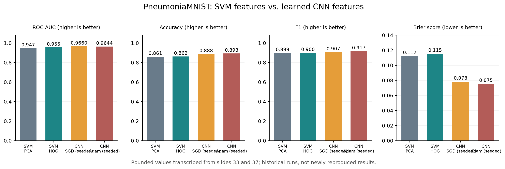
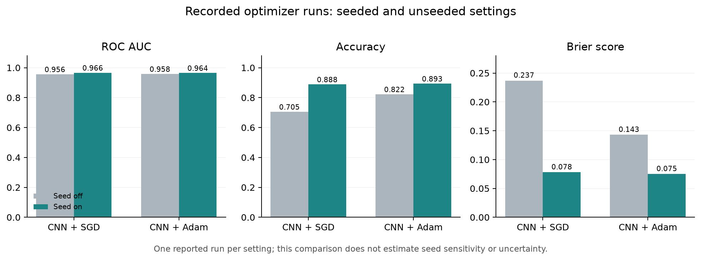
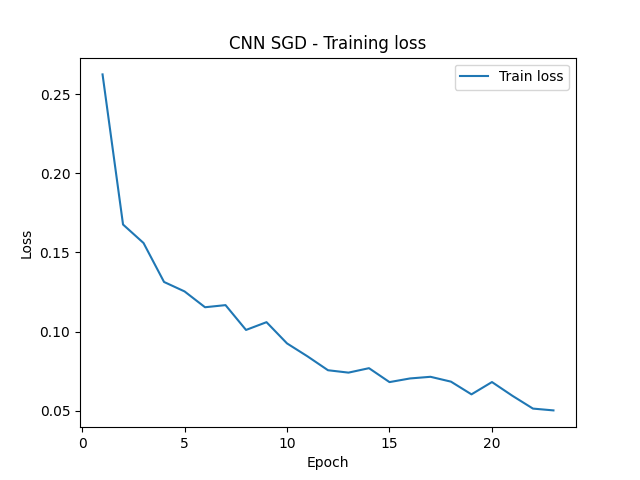
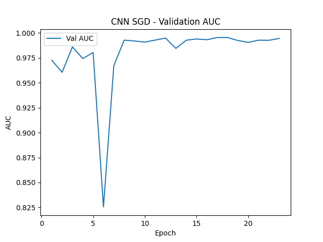

<div align="center">

# PneumoniaMNIST: SVM vs. CNN

**Matteo Lugli**  
Computational and Statistical Learning · UniMoRe  
MSc in Mathematics (Data Science) [LM-40]

[Report (PDF)](PneumoniaMNIST_MatteoLugli.pdf) · [LaTeX source](PneumoniaMNIST_MatteoLugli.tex) · [Original slides (PDF)](pneumonia_MatteoLugli.pdf) · [Code](pneumonia.py) · [Results](results/)

</div>

A course project comparing **SVMs with engineered image features** and a **compact CNN with learned features** on PneumoniaMNIST. The experiments explore PCA versus HOG, SGD with momentum versus Adam, learning-rate changes, and seeded/unseeded runs. Evaluation combines ROC AUC, accuracy, F1, Brier score, and reported runtime.



*Historical presentation results. CNN entries refer to the recorded seeded runs; these are rounded values, not newly reproduced measurements or averages across multiple runs.*

## Overview

The task is binary classification of **normal** versus **pneumonia** images in the standardized MedMNIST benchmark. The project compares four configurations:

| Model | Representation | Selection / optimization |
| --- | --- | --- |
| SVM + PCA | Standardized pixels, PCA retaining 95% variance | RBF SVM, five-fold AUC grid search |
| SVM + HOG | 9 bins, 4 × 4 pixels/cell, 2 × 2 cells/block | Standardized HOG, same SVM search |
| CNN + SGD | Three convolutional blocks and global average pooling | SGD with momentum 0.9 and StepLR |
| CNN + Adam | Same CNN architecture | Adam with learning rate 0.001 |

The English report follows the format of the [Texture Scale and Rotation Control project](https://github.com/kalkyril/texturescale-and-rotationcontrol): a two-column paper with theoretical background, implementation, experiments, discussion, conclusions, and an academic footer.

## Dataset

[PneumoniaMNIST](https://medmnist.com/) contains **5,856 grayscale images at 28 × 28 resolution**. Labels are `0 = normal` and `1 = pneumonia`. The original MedMNIST splits are retained:

| Split | Normal | Pneumonia | Total |
| --- | ---: | ---: | ---: |
| Training | 1,214 | 3,494 | 4,708 |
| Validation | 135 | 389 | 524 |
| Test | 234 | 390 | 624 |

Class counts were verified from the supplied local dataset archive; split sizes match the [official metadata](https://github.com/MedMNIST/MedMNIST/blob/main/medmnist/info.py). The training set is approximately 74.2% pneumonia, so it is not class-balanced. MedMNIST downloads the dataset on first execution; images are not bundled here.

This is an **educational benchmark study**, not a clinically validated diagnostic tool. MedMNIST explicitly describes its data as unsuitable for clinical use.

## Reported results

The following values come from the original 42-slide presentation, primarily slides 33, 34, 37, and 39. AUC values are approximate; all metrics are rounded. Accuracy and F1 use a probability threshold of 0.5 in the code. Lower Brier score is better.

| Configuration | ROC AUC | Accuracy | F1 | Brier |
| --- | ---: | ---: | ---: | ---: |
| SVM + PCA | ≈0.947 | 0.861 | 0.899 | 0.112 |
| SVM + HOG | ≈0.955 | 0.862 | 0.900 | 0.115 |
| CNN + SGD, LR 0.05, seed off | ≈0.9558 | 0.705 | 0.809 | 0.237 |
| CNN + Adam, seed off | ≈0.9579 | 0.822 | 0.875 | 0.143 |
| CNN + SGD, LR 0.05, seed on | ≈0.9660 | 0.888 | 0.907 | 0.078 |
| CNN + Adam, seed on | ≈0.9644 | 0.893 | 0.917 | 0.075 |
| CNN + SGD, LR 0.01, seed off | ≈0.9491 | 0.758 | 0.838 | not reported |

**Main observation:** the displayed seeded CNN runs outperform the SVM baselines. SGD has the highest recorded AUC, while Adam has the best accuracy, F1, and Brier score. HOG improves AUC over PCA but has a slightly worse Brier score. The unseeded CNN runs do not consistently outperform the SVMs.



*A single reported run per setting cannot establish seed sensitivity, optimizer robustness, or statistical significance. Fixing a seed makes a random trajectory repeatable; it does not inherently improve optimization.*

Slide 41 reports approximately **410 s** for SVM + HOG, **40 s** for seeded CNN + SGD, and **25–40 s** for seeded CNN + Adam. Hardware is not specified. SVM timing includes feature extraction and hyperparameter search, while CNN timing measures one configuration, so these are not equal-budget speed comparisons.

## Learning curves

The original PNG curves were extracted directly from the PowerPoint during preparation; they have not been redrawn from unavailable training histories. This repository publishes the [slide PDF](pneumonia_MatteoLugli.pdf) and the extracted PNGs; the editable PowerPoint is not included.

| Seeded SGD: training loss | Seeded SGD: validation AUC |
| --- | --- |
|  |  |

The report contains all **12 original learning curves** from slides 35, 38, and 40. Their source files and SHA-256 checksums are recorded in [figure_sources.json](results/figure_sources.json). Validation AUC curves should not be confused with the reported final evaluation AUCs in the table above.

## Getting started

For a fresh environment, Python 3.11 is a practical target for the package versions found in the supplied local virtual environment:

```bash
python3 -m venv .venv
source .venv/bin/activate
python -m pip install -r requirements-reproduction.txt
```

The pinned file records the **supplied environment snapshot**, not a verified lockfile for the historical slide runs. The original unpinned [requirements.txt](requirements.txt) is also retained.

Run all four pipelines with the current defaults (unseeded SGD at LR 0.01, maximum 40 epochs; Adam at LR 0.001, maximum 30 epochs):

```bash
python pneumonia.py
```

Example seeded run at the higher SGD learning rate:

```bash
python pneumonia.py --seed 42 --sgd-lr 0.05 --sgd-epochs 30 \
    --output-dir results_runs/seed42 --no-plots
```

Example lower-learning-rate run without fixing the seed:

```bash
python pneumonia.py --sgd-lr 0.01 --sgd-epochs 40 \
    --output-dir results_runs/lower_lr --no-plots
```

`42` is an example seed from the commented original source, not a verified historical seed. Each command runs both SVM searches and both CNN optimizers. A CUDA GPU is used when available, otherwise CPU; the code does not select Apple MPS.

Outputs include `svm_pca.json`, `svm_hog.json`, `cnn_sgd.json`, `cnn_adam.json`, CNN checkpoint files, `timings.json`, and `run_config.json`. Plotting-enabled runs also save learning-curve PNGs. `--no-plots` skips those plot windows and PNGs. Use a different output directory for each run to preserve its artifacts.

The original script is preserved in [archive/pneumonia_original.py](archive/pneumonia_original.py). The publication version fixes best-checkpoint copying with `copy.deepcopy`, adds execution options and metadata, seeds the SVM probability-fitting step when requested, and optionally saves plot images. Historical slide metrics are not regenerated or replaced by those changes.

## Evidence and limitations

- The numerical results are **transcribed from slides**. Historical prediction arrays, training-history JSONs, weights, and per-run configuration logs were not supplied.
- The original checkpoint assignment retained live tensor references. The publication version fixes this for future runs; the old results cannot be retroactively identified with the true best-validation checkpoint.
- Scaling and PCA are fitted before cross-validation. They do not use validation/test images, but the CV held-out folds influence preprocessing. A future revision should refit preprocessing within each CV fold using a scikit-learn `Pipeline`.
- `SVC(probability=True)` includes probability fitting with randomness. Calling the entire original pipeline strictly deterministic is too strong.
- A lower Brier score does not alone prove better calibration. Repeated-seed experiments, confidence intervals, reliability diagrams, and threshold analysis are needed for stronger conclusions.

The original experiment structure is retained apart from the explicit maintenance changes. Full details and slide references are in [RESULTS_AND_LIMITATIONS.md](docs/RESULTS_AND_LIMITATIONS.md).

## Repository structure

```text
.
├── README.md
├── pneumonia.py                         # publication entry point
├── requirements.txt                     # original package list
├── requirements-reproduction.txt        # supplied environment snapshot
├── PneumoniaMNIST_MatteoLugli.tex        # English report source
├── PneumoniaMNIST_MatteoLugli.pdf        # English report
├── pneumonia_MatteoLugli.pdf             # original slide export
├── assets/                              # figures and extracted learning curves
├── results/                             # slide-transcribed data and provenance
├── scripts/                             # PDF, figure, and extraction helpers
├── archive/                             # original source and original README
└── docs/                                # methodology, credits, upload guide
```

## Rebuild the report and figures

A TeX Live or MacTeX installation is required. The report supports pdfLaTeX and LuaLaTeX, including the LuaLaTeX recipe commonly used in VS Code. Build the report with:

```bash
bash scripts/build_report.sh
```

The script keeps intermediate files outside the repository and compresses embedded images if Ghostscript is available. Rebuild the comparison plots from the included CSVs with:

```bash
python scripts/build_figures.py
```

The report and plots rebuild using only the files included here. The optional slide-extraction helper requires a separately supplied copy of the original PowerPoint, which is not published:

```bash
python scripts/extract_slide_figures.py --pptx "/path/to/Progetto CSL.pptx"
```

Neither helper trains a model. The [Italian publishing guide](docs/PUBLISHING.md) lists what to include in GitHub Desktop; `.venv`, downloaded data, fresh experiment directories, weights, and LaTeX intermediates are excluded by `.gitignore`.

## Acknowledgements

This independent project was prepared by **Matteo Lugli** for **Computational and Statistical Learning**, MSc in Mathematics (Data Science) [LM-40], **University of Modena and Reggio Emilia**.

The benchmark is provided by **MedMNIST**: Jiancheng Yang, Rui Shi, Donglai Wei, Zequan Liu, Lin Zhao, Bilian Ke, Hanspeter Pfister, and Bingbing Ni, *MedMNIST v2: A Large-Scale Lightweight Benchmark for 2D and 3D Biomedical Image Classification*, Scientific Data 10, 41 (2023). [Project](https://medmnist.com/) · [Paper](https://doi.org/10.1038/s41597-022-01721-8) · [Code](https://github.com/MedMNIST/MedMNIST)

Implementation uses PyTorch, torchvision, scikit-learn, scikit-image, NumPy, Matplotlib, and tqdm. [Source and reuse notes](docs/THIRD_PARTY.md). No project-wide license has been selected for the original course material.
